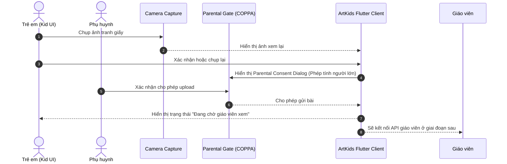
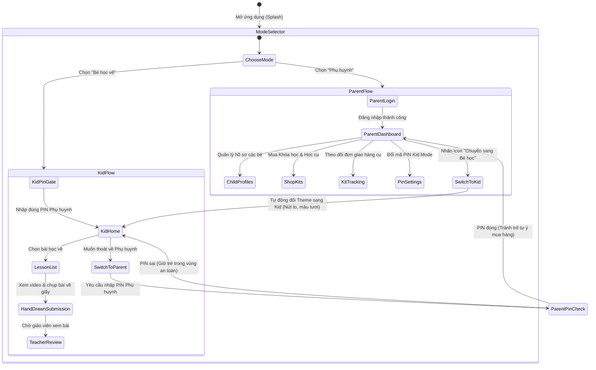

# 🎨 ArtKids Mobile App — Architecture & Scaffolding Guide

Ứng dụng di động học vẽ online kết hợp học cụ vật lý (Art Kits) dành cho trẻ em (4–12 tuổi). Trẻ học theo bài, vẽ trên giấy thật, chụp ảnh tác phẩm và gửi cho giáo viên xem.

---

## 📑 Mục lục

1. [Tổng quan Sản phẩm](#-1-tổng-quan-sản-phẩm)
2. [Kiến trúc Phần mềm: Feature-First Clean Architecture](#-2-kiến-trúc-phần-mềm-feature-first-clean-architecture)
3. [Lựa chọn Công nghệ & Đánh đổi Kỹ thuật](#-3-lựa-chọn-công-nghệ--đánh-đổi-kỹ-thuật)
   - [State Management: Riverpod](#31-state-management-riverpod)
   - [Chụp và nộp bài vẽ tay](#32-chụp-và-nộp-bài-vẽ-tay)
   - [Đồ họa 2D Animation (Rive) vs 3D Model: Phân tích & Đánh đổi](#33-đồ-họa-2d-animation-rive-vs-3d-model-phân-tích--đánh-đổi)
   - [Âm thanh: just_audio](#34-âm-thanh-just_audio)
   - [Offline Cache: Hive](#35-offline-cache-hive)
4. [Cây thư mục hoàn chỉnh (Feature-First Structure)](#-4-cây-thư-mục-hoàn-chỉnh-feature-first-structure)
5. [Sơ đồ Luồng dữ liệu: Tranh giấy → Giáo viên](#-5-sơ-đồ-luồng-dữ-liệu-tranh-giấy--giáo-viên)
6. [Sơ đồ Chuyển đổi Parent Mode ⇄ Kid Mode (Parental Gate)](#-6-sơ-đồ-chuyển-đổi-parent-mode--kid-mode-parental-gate)
7. [Cấu hình Đa môi trường (Dev / Staging / Prod) & Flavors](#-7-cấu-hình-đa-môi-trường-dev--staging--prod--flavors)
8. [Hướng dẫn Chạy trên Android Emulator & Cấu hình khuyến nghị](#-8-hướng-dẫn-chạy-trên-android-emulator--cấu-hình-khuyến-nghị)
9. [Bảo mật & Tuân thủ Quyền riêng tư Trẻ em (COPPA / GDPR-K)](#-9-bảo-mật--tuân-thủ-quyền-riêng-tư-trẻ-em-coppa--gdpr-k)
10. [Danh mục Backend Services & API Endpoints](#-10-danh-mục-backend-services--api-endpoints)

---

## 🌟 1. Tổng quan Sản phẩm

- **Đối tượng người dùng**:
  - **Phụ huynh (Parent Mode)**: Đăng ký/đăng nhập, mua khóa học, đăng ký gói định kỳ (subscription) nhận kit học cụ vật lý gửi tận nhà, theo dõi tiến độ học và lịch sử tác phẩm của con, thiết lập mã PIN bảo vệ.
 - **Trẻ em (Kid Mode)**: Giao diện trực quan kích thước lớn, màu sắc sinh động, tối giản chữ viết, hỗ trợ đọc giọng nói (TTS), học bài và gửi ảnh tranh giấy cho giáo viên.

---

## 🏛️ 2. Kiến trúc Phần mềm: Feature-First Clean Architecture

Dự án áp dụng **Feature-First Clean Architecture** (Tổ chức theo tính năng kết hợp phân tầng Clean Architecture).

```
                     ┌──────────────────────────────────────┐
                     │          Presentation Layer          │
                     │  (Screens, Widgets, StateNotifier)   │
                     └──────────────────┬───────────────────┘
                                        │ (uses)
                                        ▼
                     ┌──────────────────────────────────────┐
                     │             Domain Layer             │
                     │    (Entities, Use Cases, Repos)      │
                     └──────────────────▲───────────────────┘
                                        │ (implements)
                     ┌──────────────────┴───────────────────┐
                     │              Data Layer              │
                     │ (DataSources, Models, Repositories)  │
                     └──────────────────────────────────────┘
```

### Tại sao chọn Feature-First kết hợp Clean Architecture?
1. **Module hóa theo nghiệp vụ (High Cohesion)**: Toàn bộ code của `hand_drawn_submission`, `matching_game`, hay `parent_dashboard` gom gọn trong một thư mục. Khi cần sửa tính năng vẽ, lập trình viên không phải nhảy qua lại giữa hàng chục folder tầng khác nhau.
2. **Khả năng mở rộng (Scalability)**: Dễ dàng chia task cho nhiều dev/squad làm song song mà không bị merge conflict.
3. **Độc lập và Testability**: Tầng Domain là thuần Dart (không phụ thuộc Flutter UI hay Dio/Hive). Dễ dàng viết Unit Test cho Use Case mà chỉ cần mock Repository interface.

---

## ⚙️ 3. Lựa chọn Công nghệ & Đánh đổi Kỹ thuật

### 3.1. State Management: Riverpod
- **Lý do lựa chọn**:
  - **Quản lý bất đồng bộ mạnh mẽ (`AsyncNotifier`, `FutureProvider.family`, `StreamProvider`)**: Riverpod xử lý tải bài học, tiến độ và các trạng thái mạng qua `.when()`.
  - **Dependency Injection (DI) tích hợp sẵn**: Không cần setup `get_it` phức tạp.
  - **An toàn Compile-time & Không phụ thuộc BuildContext**: Cho phép đọc hoặc mutate state bên ngoài Widget tree (ví dụ: trong background message handler của Firebase FCM).

### 3.2. Chụp và nộp bài vẽ tay
- Trẻ thực hiện bài học bằng giấy và dụng cụ vẽ thật, không phải trên canvas của ứng dụng.
- `image_picker` mở camera để chụp tác phẩm; trẻ có thể xem lại, chụp lại hoặc xác nhận.
- Ứng dụng hiển thị trạng thái chờ giáo viên xem. API teacher/submission sẽ được nối ở giai đoạn sau.

### 3.3. Đồ họa 2D Animation (Rive) vs 3D Model: Phân tích & Đánh đổi

| Tiêu chí | 2D Animation (Rive / Lottie) | 3D Model Rendering (model_viewer_plus / Filament) |
| :--- | :--- | :--- |
| **Công nghệ** | Native Skia/Impeller Vector Canvas | WebGL WebView / OpenGL ES / Filament native engine |
| **Tiêu tốn RAM** | **Thấp** (~15 – 35 MB) | **Cao** (~120 – 260 MB do nạp 3D Textures & Meshes) |
| **FPS trên Android Emulator** | **60 FPS ổn định**, mượt mà | Dễ bị giật nếu Emulator chạy CPU Software GPU (SwiftShader) |
| **Thiết bị Android tầm trung** | Hoạt động trơn tru trên chip MediaTek G88 / Snapdragon 680 | Có thể nóng máy, tụt pin nhanh nếu tương tác lâu |
| **Trải nghiệm trẻ em (4-12t)** | Nhân vật hoạt hình 2D sống động, màu sắc tươi vui | Xoay 360 độ tương tác cao, nhưng dễ gây quá tải thiết bị |
| **Chiến lược áp dụng trong app** | **Mặc định ưu tiên (Primary)** | **Tùy chọn nâng cao (Secondary/Fallback)** khi máy có GPU mạnh |

### 3.4. Âm thanh: just_audio
- Hỗ trợ stream trực tiếp từ CDN URL, cache âm thanh cục bộ và phát song song nhiều luồng (ví dụ tiếng động vật kêu + nhạc nền nhẹ).

### 3.5. Offline Cache: Hive
- NoSQL Key-Value siêu nhẹ, viết hoàn toàn bằng Dart, tốc độ đọc/ghi nhanh gấp nhiều lần SQLite.
- Dùng lưu trữ cache danh sách bài học đã tải, metadata con vật đã sinh, và cài đặt ứng dụng.

---

## 📁 4. Cây thư mục hoàn chỉnh (Feature-First Structure)

```
apps/artkids_app/
├── android/                             # Cấu hình Native Android
│   ├── app/
│   │   ├── build.gradle.kts             # Cấu hình Flavors (dev, staging, prod) & SDK
│   │   └── src/main/
│   │       └── AndroidManifest.xml      # Quyền: Camera, Storage, Notification, Internet
├── env/                                 # File cấu hình biến môi trường
│   ├── dev.env                          # Môi trường Dev (API 10.0.2.2 cho Android Emulator)
│   ├── staging.env                      # Môi trường Staging (Cloud test)
│   └── prod.env                         # Môi trường Production
├── assets/
│   ├── animations/                      # Rive (.riv) & Lottie (.json) files
│   ├── audio/                           # Sound effects (.mp3 / .wav)
│   └── images/                          # Icons, Badges, Brand assets
├── lib/
│   ├── app.dart                         # MaterialApp.router, dynamic theme (Parent vs Kid)
│   ├── bootstrap.dart                   # Khởi tạo Hive, FCM, Dotenv trước runApp
│   ├── main.dart                        # Entry point chính
│   │
│   ├── core/                            # Tầng dùng chung toàn app
│   │   ├── config/                      # env_config.dart (đọc biến môi trường)
│   │   ├── constants/                   # api_constants.dart, kid_ui_constants.dart
│   │   ├── error/                       # app_exception.dart, failure.dart
│   │   ├── firebase/                    # fcm_service.dart (Push notification)
│   │   ├── network/                     # dio_client.dart, api_interceptor.dart
│   │   ├── routing/                     # app_router.dart (GoRouter), route_paths.dart
│   │   ├── storage/                     # hive_boxes.dart, local_storage_service.dart
│   │   ├── theme/                       # app_theme.dart (Theme riêng cho Parent & Kid)
│   │   ├── utils/                       # coppa_compliance.dart, device_capability_checker.dart
│   │   └── widgets/                     # kid_button.dart
│   │
│   └── features/                        # Các module tính năng (Feature-First)
│       ├── auth/                        # Xác thực Phụ huynh & Quản lý hồ sơ Con
│       │   ├── data/                    # datasources, models, repositories
│       │   ├── domain/                  # entities (ParentUser, ChildProfile), usecases, repo interfaces
│       │   └── presentation/            # login_screen, mode_selector, providers
│       │
│       ├── courses/                     # Khóa học vẽ & Bài giảng video
│       │   ├── data/                    # course_remote_datasource, course_model, lesson_model
│       │   ├── domain/                  # Course, Lesson, course_repository
│       │   └── presentation/            # providers (FutureProvider), screens, widgets
│       │
│       ├── hand_drawn_submission/      # Chụp ảnh tranh giấy và chờ giáo viên xem
│       │   └── presentation/            # hand_drawn_submission_screen
│       │
│       ├── kid_mode/                    # Chế độ Trẻ em (UI tối giản, PIN gate, TTS giọng nói)
│       │   ├── domain/                  # KidReward entity (huy hiệu, cúp)
│       │   └── presentation/            # app_mode_provider, voice_guidance_provider, kid_home_screen
│       │
│       ├── parent_dashboard/            # Quản lý giao nhận học cụ & Báo cáo tiến độ
│       │   ├── data/                    # parent_dashboard_datasource, kit_delivery_model
│       │   ├── domain/                  # KitDelivery, ChildProgressReport
│       │   └── presentation/            # parent_home_screen, kit_tracking_screen
│       │
│       └── shop/                        # Mua subscription & Combo khóa học + Kit học cụ
│           ├── data/                    # shop_remote_datasource, subscription_plan_model
│           ├── domain/                  # SubscriptionPlan, shop_repository
│           └── presentation/            # shop_provider, subscription_plans_screen
│
└── pubspec.yaml                         # Khai báo thư viện & asset
```

---

## 🔄 5. Sơ đồ Luồng dữ liệu: Tranh giấy → Giáo viên



---

## 🔐 6. Sơ đồ Chuyển đổi Parent Mode ⇄ Kid Mode (Parental Gate)



---

## 🌐 7. Cấu hình Đa môi trường (Dev / Staging / Prod) & Flavors

Dự án thiết lập 3 môi trường tách biệt thông qua Flutter flavors và `flutter_dotenv`:

| Môi trường | File Env | Package / Application ID | API Base URL |
| :--- | :--- | :--- | :--- |
| **Development** | `env/dev.env` | `com.artkids.artkids_app.dev` | `http://10.0.2.2:3000/api/v1` *(Local Emulator Gateway)* |
| **Staging** | `env/staging.env` | `com.artkids.artkids_app.staging` | `https://staging-api.artkids.app/api/v1` |
| **Production** | `env/prod.env` | `com.artkids.artkids_app` | `https://api.artkids.app/api/v1` |

### Lệnh chạy ứng dụng theo từng môi trường:

```bash
# 1. Chạy trên môi trường Dev (Dành cho Android Emulator)
flutter run --flavor dev --dart-define=FLAVOR=dev -t lib/main.dart

# 2. Chạy trên môi trường Staging
flutter run --flavor staging --dart-define=FLAVOR=staging -t lib/main.dart

# 3. Build APK / App Bundle Production
flutter build appbundle --flavor prod --dart-define=FLAVOR=prod -t lib/main.dart
```

---

## 📱 8. Hướng dẫn Chạy trên Android Emulator & Cấu hình khuyến nghị

### Cấu hình Android Emulator khuyến nghị (Android Studio AVD Manager):
Để đảm bảo đồ họa 2D Canvas, Animation và âm thanh chạy mượt mà $60\text{ FPS}$:
- **Device Definition**: Pixel 6 / Pixel 7 hoặc Galaxy Tab S8 (màn hình tablet vẽ cho bé rất tốt).
- **System Image**: **Android 14 (API Level 34)** hoặc **Android 13 (API Level 33)** — Kiến trúc `x86_64` (hoặc `arm64-v8a` trên Apple Silicon).
- **RAM**: Tối thiểu **4096 MB (4 GB)**.
- **VM Heap**: Tối thiểu **512 MB**.
- **Internal Storage**: Tối thiểu **8 GB**.
- **Graphics Acceleration (Rất quan trọng)**: Chọn **`Hardware - GLES 2.0`** (Sử dụng trực tiếp GPU máy tính Host thay vì CPU mô phỏng).

> 💡 **Mẹo kết nối mạng trên Android Emulator**:
> Địa chỉ IP `10.0.2.2` trên Android Emulator trỏ trực tiếp về `localhost` của máy host tính. Vì vậy file `dev.env` đã được cấu hình sẵn `http://10.0.2.2:3000` để kết nối thẳng vào backend microservices đang chạy trên máy dev của bạn.

---

## 🛡️ 9. Bảo mật & Tuân thủ Quyền riêng tư Trẻ em (COPPA / GDPR-K)

1. **Nguyên tắc giảm thiểu thu thập dữ liệu (Data Minimization)**:
   - Hồ sơ trẻ chỉ lưu `nickname` và `tuổi` (để phân cấp độ khó của bài học).
   - Tuyệt đối không yêu cầu họ tên thật, email, số điện thoại hay trường học của trẻ.
2. **Không lưu trữ dữ liệu nhận dạng khuôn mặt (Biometrics/Face Detection)**:
   - Khi trẻ chụp ảnh bài vẽ tay bằng Camera, app chỉ dùng ảnh cho luồng nộp bài giáo viên.
3. **Cơ chế Xác thực Phụ huynh (Parental Consent Gate)**:
   - Trước khi gửi ảnh bài vẽ hoặc chuyển từ Kid Mode sang Parent Mode, app bắt buộc vượt qua phép tính xác thực hoặc nhập mã PIN của phụ huynh.
4. **Bảo mật cục bộ**:
   - Token xác thực và mã PIN được mã hóa lưu trong Android Keystore / Flutter Secure Storage.

---

## 🔌 10. Danh mục Backend Services & API Endpoints

App Flutter giao tiếp với hệ thống Backend thông qua API Gateway tại các endpoint sau:

| Service | Chức năng chính | Các API Endpoint chính mà App gọi |
| :--- | :--- | :--- |
| **`auth-service`** | Xác thực phụ huynh, hồ sơ con, PIN | `POST /auth/login`<br/>`POST /auth/register`<br/>`POST /auth/kid-pin/verify`<br/>`GET /children` |
| **`course-service`** | Khóa học, bài học, video hướng dẫn | `GET /courses`<br/>`GET /courses/{id}/lessons`<br/>`POST /progress` |
| **`commerce-service`** | Đăng ký subscription, mua combo kit | `GET /commerce/subscriptions`<br/>`POST /commerce/checkout` |
| **`inventory-fulfillment`** | Đóng gói & Vận chuyển hộp học cụ | `GET /parent/fulfillments` (tra cứu mã tracking bưu cục) |
| **`submission-service`** | Nhận tranh vẽ & điều phối job AI | `POST /kid/submissions` (Upload multipart tranh vẽ)<br/>`GET /kid/submissions/{id}/status` |
| **`ai-generation-service`** | Phân loại loài vật, sinh rig 2D/3D | Xử lý ngầm qua Queue $\rightarrow$ lưu asset vào CDN |
| **`media-service`** | Lưu trữ CDN (video, model, sound) | `GET /media/{assetId}`<br/>`POST /media/presigned-url` |
| **`notification-service`** | Gửi push Firebase khi AI xong việc | Firebase Cloud Messaging Topic & Token push |
